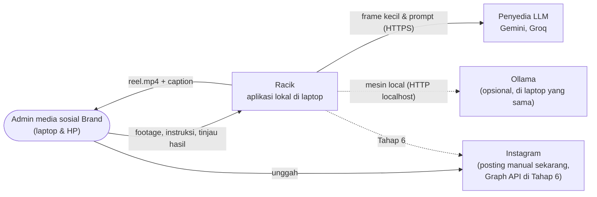
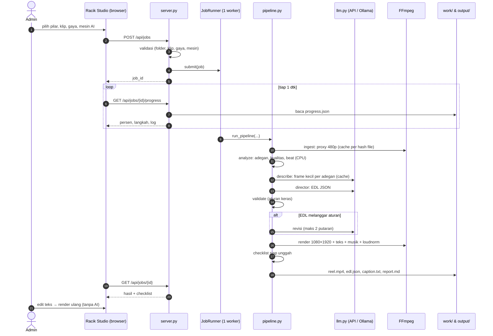

# Arsitektur Racik (AutoReels)

Dokumen arsitektur sistem pengubah video mentah menjadi video siap unggah untuk Contoh Brand.
Spesifikasi lengkap ada di [CLAUDE.md](../../CLAUDE.md); dokumen ini merangkum **bentuk sistem, alasan keputusannya,
dan risikonya**.

| File | Isi |
|---|---|
| `README.md` | ringkasan kebutuhan, diagram (konteks, kontainer, alur job), teknologi, risiko |
| [`arsitektur.mmd`](arsitektur.mmd) | diagram kontainer (Mermaid) — bisa ditempel ke draw.io / mermaid.live |
| [`arsitektur.drawio`](arsitektur.drawio) / [`arsitektur.xml`](arsitektur.xml) | diagram kontainer yang sama untuk draw.io (isi identik; `.xml` untuk alat yang meminta ekstensi XML) |
| [`adr/`](adr/) | catatan keputusan arsitektur (ADR-001 … ADR-008) |

Terakhir ditinjau: 2026-11-20.

---

## 1. Ringkasan kebutuhan

### Fungsional
1. Mengubah 1–n video mentah + instruksi bahasa Indonesia menjadi video 9:16 siap unggah (hook ≤ 3 dtk, teks, musik, logo, CTA).
2. Pengguna memilih pilar konten, klip footage (dengan preview), gaya, durasi, musik, voice over, dan mesin AI (API/lokal).
3. Hasil bisa ditinjau, diedit teksnya, dan **dirender ulang dari EDL tanpa memanggil AI lagi**.
4. Setiap hasil wajib lolos *Checklist Siap Unggah*; bila gagal ditandai `perlu_tinjau` dengan alasannya.
5. Mengimpor video yang sudah diedit di tempat lain (video-use) menjadi paket siap unggah.
6. Mengelola "bahan AI": pustaka hook, hashtag & keyword, brief tren mingguan, brand & gaya caption.
7. (Tahap 6, rencana) Menjadwalkan & memposting ke Instagram lewat API resmi dengan persetujuan manusia.

### Non-fungsional
| Aspek | Target / batasan | Sumber |
|---|---|---|
| Pengguna | 1–2 admin media sosial, satu laptop; HP lewat Wi-Fi yang sama | konteks Brand |
| Beban | 1 job berjalan sekaligus; ±beberapa video per hari | laptop tunggal |
| Waktu proses | menit per video (bukan detik); UI harus menampilkan progres real-time | sifat render & LLM |
| Biaya | minim: tanpa server cloud, API murah, cache semua respons LLM, biaya dicatat per job | prinsip 1 & 5 |
| Perangkat | wajib jalan di laptop CPU + API; GPU hanya opsional (mesin lokal) | prinsip 1, ADR-006 |
| Ketersediaan | alat internal: cukup saat laptop menyala (tanpa target uptime) | — |
| Keamanan & privasi | hanya `127.0.0.1`; mode HP pakai PIN; API key di `.env` (tidak di-commit); blur wajah/pelat (rencana) | prinsip 6 |
| Kepatuhan platform | tanpa scraper; musik hanya bebas royalti; Instagram hanya API resmi | prinsip 6 |
| Pemeliharaan | prompt & konfigurasi di file (bukan di kode); EDL = kontrak tunggal yang divalidasi pydantic | prinsip 3, ADR-002 |

---

## 2. Diagram

### 2.1 Konteks sistem (C4 level 1)

### 2.2 Kontainer & komponen (C4 level 2)

Diagram lengkap: [`arsitektur.mmd`](arsitektur.mmd) / [`arsitektur.drawio`](arsitektur.drawio).
Ringkasnya, Racik adalah **monolit modular lokal** (ADR-001) dengan lima lapisan:

| Lapisan | Komponen | Tanggung jawab |
|---|---|---|
| Antarmuka | Racik Studio (React, `frontend/`), menu `main.py`, CLI `autoreels` | input pengguna, preview, tinjau hasil |
| Aplikasi | `server.py` (FastAPI + `JobRunner` 1 worker), `importer.py` | API, antrean job, progres, penyaji media |
| Domain | `pipeline.py` → ingest, analyze, describe, director, validate, critic, render, checklist | edit otomatis; LLM hanya menulis EDL |
| Integrasi | `llm.py` (litellm + klien Ollama), `media.py` (ffmpeg/ffprobe) | semua panggilan luar lewat satu pintu |
| Data | `footage/`, `work/`, `output/`, `config/`, `prompts/`, `trends/`, `assets/` | file lokal, tanpa database (ADR-004) |

### 2.3 Alur satu job (dari web)

---

## 3. Keputusan arsitektur (ADR)

| ADR | Keputusan | Status |
|---|---|---|
| [001](adr/ADR-001-monolit-modular-lokal.md) | Monolit modular yang berjalan lokal di laptop | Diterima |
| [002](adr/ADR-002-edl-sebagai-kontrak.md) | LLM hanya menulis EDL JSON; FFmpeg mengeksekusi | Diterima |
| [003](adr/ADR-003-validator-deterministik.md) | Validator aturan keras + loop revisi, bukan percaya LLM | Diterima |
| [004](adr/ADR-004-penyimpanan-berbasis-file.md) | Penyimpanan berbasis file, tanpa database | Diterima |
| [005](adr/ADR-005-antrean-satu-worker.md) | Antrean job dalam proses dengan 1 worker | Diterima (lihat risiko R1, R3) |
| [006](adr/ADR-006-mesin-ai-api-dan-lokal.md) | Mesin AI ganda: API default, Ollama opsional tanpa cadangan diam-diam | Diterima (uji coba) |
| [007](adr/ADR-007-frontend-react-dist.md) | Frontend React; hasil build di-commit & disajikan FastAPI | Diterima |
| [008](adr/ADR-008-akses-hp-lan-pin.md) | Akses HP lewat LAN + PIN, tanpa cloud | Diterima (lihat risiko R4) |
| [009](adr/ADR-009-blur-privasi-yunet.md) | Blur privasi wajah & pelat dengan YuNet (OpenCV), pilihan manusia, default mati | Diterima |

---

## 4. Teknologi & alasannya

| Kebutuhan | Pilihan | Alasan | Alternatif yang ditolak |
|---|---|---|---|
| Bahasa & skema | Python 3.11+, pydantic v2 | ekosistem video/AI terlengkap; validasi EDL ketat | Node.js (pustaka video & CV lebih terbatas) |
| Render | FFmpeg + libass (subprocess) | deterministik, cepat di CPU, teks berkualitas | MoviePy (lambat), editor GUI (tidak otomatis) |
| Analisis | PySceneDetect, OpenCV, MediaPipe, librosa | semua jalan di CPU | model deteksi berbasis GPU (melanggar prinsip 1) |
| LLM | litellm (API) + HTTP langsung ke Ollama | ganti provider lewat `.env`; Ollama butuh opsi khusus (think, format, num_ctx) | SDK per provider (kode bercabang) |
| Backend web | FastAPI | ringan, satu proses dengan pipeline, OpenAPI gratis | Flask (kurang tipe), Django (terlalu berat) |
| Frontend | React + Vite + Tailwind | komponen interaktif (wizard, preview, timeline); build statis | Gradio (rencana awal Tahap 5; tampilan terbatas) |
| Data | file JSON/YAML/MD | 1 pengguna, mudah dibaca & dicadangkan, bisa diedit manual | SQLite (belum perlu query/relasi) |

---

## 5. Risiko & mitigasi

| # | Risiko / mode gagal | Dampak | Mitigasi saat ini | Usulan (belum dikerjakan) |
|---|---|---|---|---|
| R1 | Server dimatikan saat job berjalan: antrean di memori hilang | job "menggantung" di UI | ✅ 2026-11-20: saat server mulai, job "berjalan" tanpa proses ditandai *terhenti* + alasan (`mark_stale_jobs`); pindah halaman/refresh menyambung lewat `GET /api/jobs/active` | antrean tahan restart (belum perlu) |
| R2 | Server lama masih jalan setelah kode diperbarui (frontend baru, backend lama) | fitur baru tampak rusak (mis. preview) | pesan UI menyarankan restart | endpoint `/api/version`; UI memberi tahu bila versi backend tertinggal |
| R3 | CLI dan web menjalankan job bersamaan | berebut CPU/GPU/VRAM, sangat lambat atau gagal | ✅ 2026-11-20: kunci bersama `work/.job.lock` (`autoreels/joblock.py`): job web menunggu, CLI menolak dengan pesan jelas; kunci proses mati diambil alih | — |
| R4 | PIN mode HP 6 digit | orang lain di Wi-Fi yang sama bisa menebak PIN | ✅ 2026-11-20: 5 PIN salah dari satu perangkat → dikunci 60 dtk; cookie 12 jam | matikan otomatis setelah idle |
| R5 | Kuota/limit API habis | job menunggu lama atau gagal | tunggu & coba ulang hingga 15 mnt; model cadangan; mesin lokal | — |
| R6 | Model lokal lambat / tidak muat VRAM 6 GB | proses sangat lambat | batas gambar per request, `num_ctx`, varian `-instruct`, log token & waktu | pilih model per tahap dari web; peringatan bila model tidak muat penuh di GPU |
| R7 | LLM mengarang fakta (harga, tren, tempat) | konten salah terunggah | prompt melarang; placeholder `[HARGA]` ditolak checklist; brief tren manual | Critic menilai konsistensi brand & fakta (Tahap 4 ✅) |
| R8 | Musik berhak cipta masuk folder mood | video dibisukan / teguran akun | aturan di `assets/music/README.md`, `LISENSI.md` | checklist: tolak lagu yang tidak tercatat di `LISENSI.md` |
| R9 | Disk penuh oleh `work/` (proxy, cache) dan `output/` | render gagal | — | perintah `autoreels bersihkan` (hapus cache > N hari) |
| R10 | Posting ke akun produksi tanpa sengaja (Tahap 6) | konten salah tayang publik | rencana: `IG_TARGET=test` default, persetujuan manusia wajib | — |

R1, R3, R4 sudah ditangani (2026-11-20). Usulan berikutnya: R2 dan R9.
